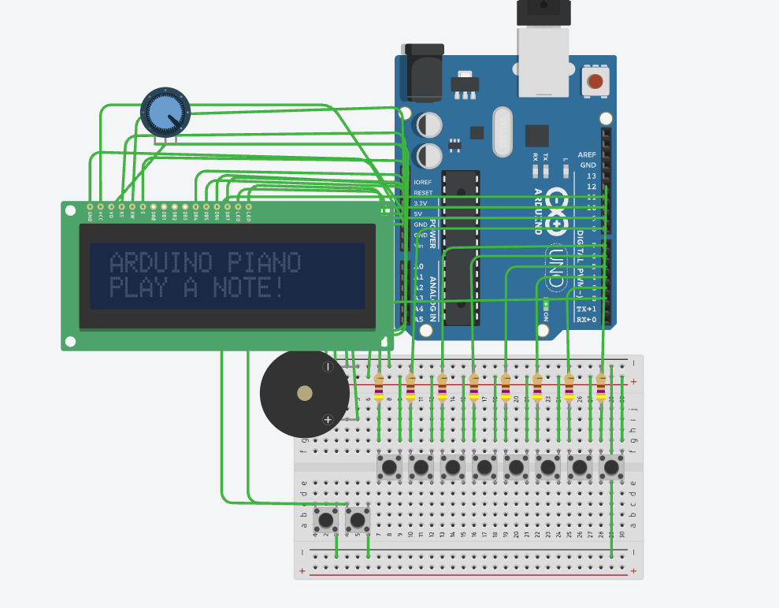
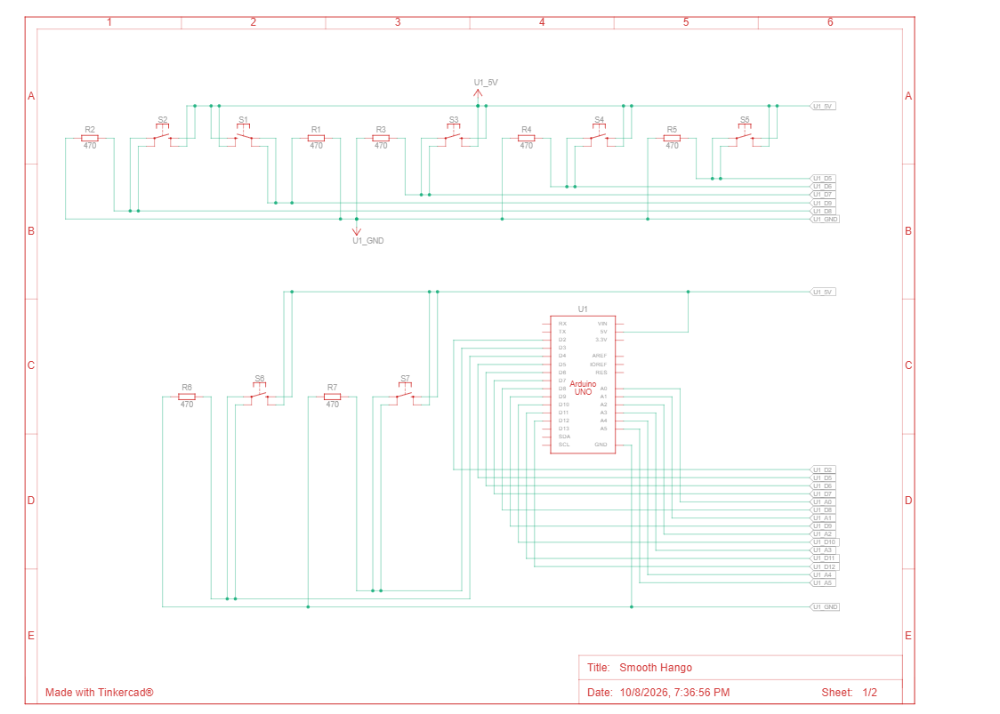
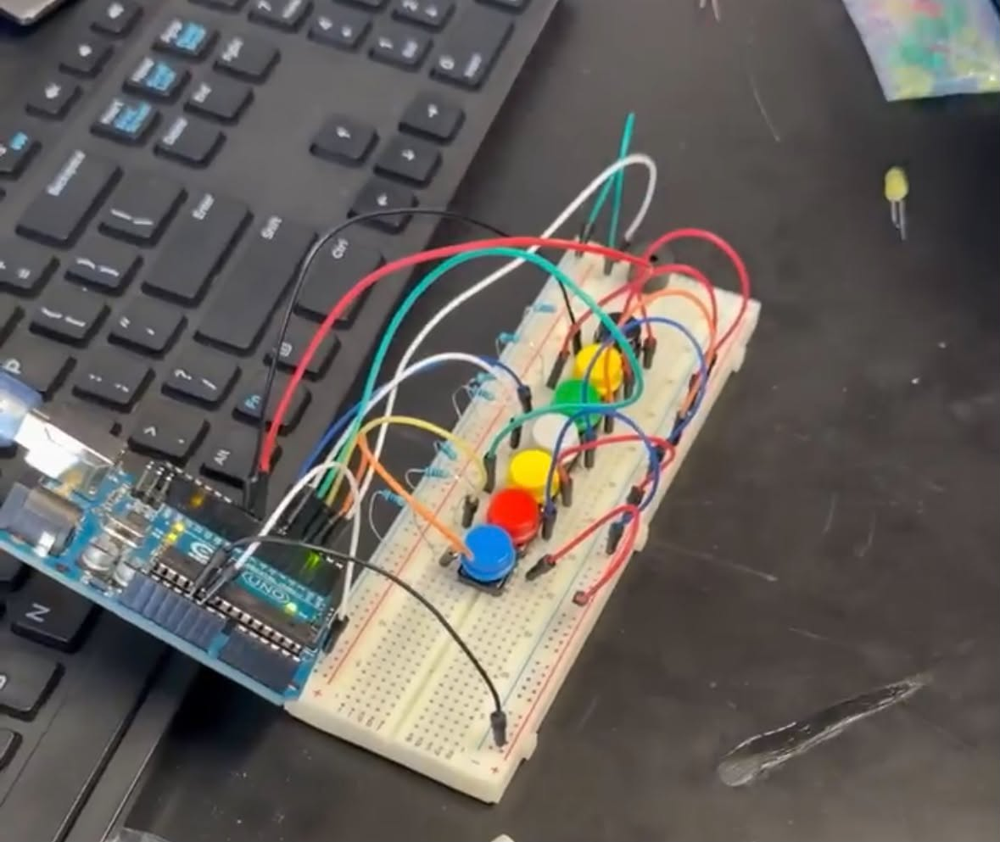

# Arduino Digital Piano

An eight-key C-major piano (C4–C5) on an Arduino Uno, with two preprogrammed
melodies and an animated 16×2 LCD. Built in TinkerCad and on physical hardware.

ENES100 Introduction to Engineering Design, Howard Community College,
October 2026.

<p align="center">
  
</p>

## Overview

Eight momentary pushbuttons map to the white-key notes of the C-major scale.
Pressing a key drives a passive piezo at that note's frequency and shows the
note name, solfège syllable and frequency on the LCD. Two further buttons play
the ABC Alphabet Song and "Mary Had a Little Lamb" while a three-frame custom
character animates on the display.

The project covers digital input design, pull-down versus pull-up conventions,
frequency generation, and the hardware/software integration problems that only
appear once a circuit is physically built.

## Engineering Objectives

1. Implement all eight notes from C4 through C5.
2. Produce audible, distinct pitches from a passive piezo.
3. Display the selected note on a character LCD.
4. Offer two preprogrammed melodies.
5. Animate the display during automatic playback.

## Hardware

| Component | Qty | Purpose |
|---|---|---|
| Arduino Uno (or compatible) | 1 | Reads inputs, generates tones, drives the LCD |
| Momentary pushbuttons | 10 | Eight notes, two song selections |
| 470 Ω resistors | 8 | External pull-downs for the note buttons |
| Passive piezo sounder | 1 | Audio output |
| 16×2 HD44780 LCD | 1 | Note, frequency and animation display |
| 10 kΩ potentiometer | 1 | LCD contrast (VO) |
| Breadboard, jumper wires, USB cable | — | Assembly and power |

### Note mapping

| Key | Note | Solfège | Frequency (Hz) | Pin |
|---|---|---|---|---|
| 1 | C4 | Do | 262 | D9 |
| 2 | D4 | Re | 294 | D8 |
| 3 | E4 | Mi | 330 | D7 |
| 4 | F4 | Fa | 349 | D6 |
| 5 | G4 | Sol | 392 | D5 |
| 6 | A4 | La | 440 | D4 |
| 7 | B4 | Ti | 494 | D3 |
| 8 | C5 | Do | 523 | D12 |

### Other connections

| Signal | Connection |
|---|---|
| Piezo + | D2 (− to GND) |
| ABC song button | D10 → GND, internal pull-up |
| Mary song button | D11 → GND, internal pull-up |
| LCD RS, E | A0, A1 |
| LCD DB4–DB7 | A2, A3, A4, A5 |
| LCD RW | GND (write-only) |
| LCD VO | Potentiometer wiper |

<p align="center">
  
</p>

## Design

### Two deliberately different input conventions

The eight note buttons use `INPUT` with **external 470 Ω pull-downs**: released
reads `LOW`, pressed connects the pin to 5 V and reads `HIGH`. The two song
buttons use `INPUT_PULLUP`: they read `HIGH` at rest and `LOW` when pressed to
ground.

Mixing conventions in one circuit is unusual, and the reason is worth stating —
the song buttons need no external parts, while the note buttons were wired with
discrete pull-downs. The pull-down matters either way: without it a released
input floats and picks up stray charge, producing notes nobody pressed.

### Note frequencies

Equal temperament relates adjacent semitones by

```
f(n) = 440 · 2^((n − 69)/12)
```

where *n* is the MIDI note number and A4 (MIDI 69) is 440 Hz. C5 sits an octave
above C4, so 523 ≈ 2 × 262 Hz. The sketch stores rounded integer frequencies,
which is the resolution `tone()` works at.

### Software structure

| Function | Role |
|---|---|
| `setup()` | Pin modes, serial, LCD init, registers three custom characters |
| `showIdleScreen()` | Default two-line prompt |
| `showManualNote()` | Note name, solfège and frequency for a pressed key |
| `danceGirl()` | Selects one of three LCD character frames |
| `playNote()` | Advances a frame, sounds a pitch, waits, stops |
| `playSong()` | Steps through a melody/duration pair, then restores the idle screen |
| `playABC()` / `playMary()` | Supply the respective melody and duration arrays |
| `manualPiano()` | Scans the eight keys, sounds the first pressed |
| `loop()` | Detects song-button edges, otherwise scans the keyboard |

Melody data is stored separately from playback logic, so both songs share one
`playSong()` routine. `lastManualNote` tracks the active key so the LCD is
rewritten only when the note changes — without it, `lcd.clear()` would run every
loop iteration and the display would visibly flicker.

## Debugging: the C5 key

The most instructive problem in the build. C5 on D12 behaved backwards — the
piezo sounded while the button was *released* and stopped when pressed.

The pin was configured in a mode that did not match how the button was
physically wired, so the logic sense was inverted relative to the other seven
keys. The fix was to make D12 match them: `INPUT` mode, external pull-down,
`HIGH` means pressed.

```cpp
// FIXED: C5 now behaves like other keys
pinMode(c5Note, INPUT);
```

Software input configuration has to match the actual circuit. Code that compiles
and looks right will still behave backwards if the pin mode contradicts the
wiring.

## Testing

<p align="center">
  
</p>

Simulated in TinkerCad, then assembled on a breadboard. All eight keys and both
melodies were demonstrated on the physical build.

**The LCD was not demonstrated on hardware.** The display supplied with the lab
kit was faulty and could not show output reliably. The LCD code paths are fully
implemented and work in simulation, but the physical demonstration ran without
the display. This is a hardware fault, not a software limitation.

## How to Build

1. Install the [Arduino IDE](https://www.arduino.cc/en/software). `LiquidCrystal`
   ships with it — no extra libraries needed.
2. Wire the circuit per the tables above: each note button between its pin and
   5 V with a 470 Ω pull-down to ground; song buttons between their pins and
   ground; piezo + on D2; LCD in 4-bit mode on A0–A5 with the potentiometer on VO.
3. Open `src/Arduino_Piano_Code.ino`, select **Arduino Uno**, and upload.
4. Serial monitor at 9600 baud reports the note being played.

To run it in simulation instead, rebuild the circuit in TinkerCad and paste the
sketch into its code editor.

## Known Issues and Improvements

**Known issues**

- `playSong()` uses blocking `delay()`, so the keyboard is unresponsive until a
  melody finishes.
- `manualPiano()` is an `if`/`else if` chain, so only one note sounds at a time.
  This is inherent to `tone()`, which drives a single frequency per pin.
- The eight note buttons are not debounced. It matters less here than for the
  song buttons — which do use a 30 ms debounce plus an edge check — because a
  held key simply re-sounds the same pitch.
- 470 Ω is low for a pull-down. It works, but it draws roughly 10 mA per pressed
  key; 10 kΩ would do the same job at a fraction of the current.

**Worth doing next**

- Replace `delay()` with a `millis()` state machine so songs can be interrupted.
- Debounce the note buttons.
- Read the keys through a resistor ladder on one analogue pin, or a shift
  register, freeing digital pins.
- Add note polyphony via a hardware timer, or velocity sensing with
  piezo-as-input.

## A Note on the Report

`docs/technical-report.pdf` contains the full write-up. Two items in it are
inconsistent with the circuit as built, and are corrected in this README:

- Section 2.1 and a comment in `setup()` describe **10 kΩ** pull-downs. The
  materials table, Section 5, and the schematic all show **470 Ω**. The
  schematic is authoritative.
- The schematic figure is marked "Sheet 1/2"; only sheet 1 is reproduced, so the
  piezo and LCD connections appear in the wiring tables rather than the drawing.

The report also includes a section reflecting on the use of an AI assistant
during development, and the conclusion it reaches — that generated code cannot
confirm how a physical switch is wired, which is exactly what the C5 bug turned
out to be — is the honest one.

## Repository Structure

```
.
├── src/
│   └── Arduino_Piano_Code.ino    complete sketch, 521 lines
├── docs/
│   └── technical-report.pdf      full report with derivations and walkthrough
├── images/
│   ├── 01-tinkercad-simulation.png
│   ├── 02-hardware-breadboard.png
│   └── 03-tinkercad-schematic.png
└── README.md
```
